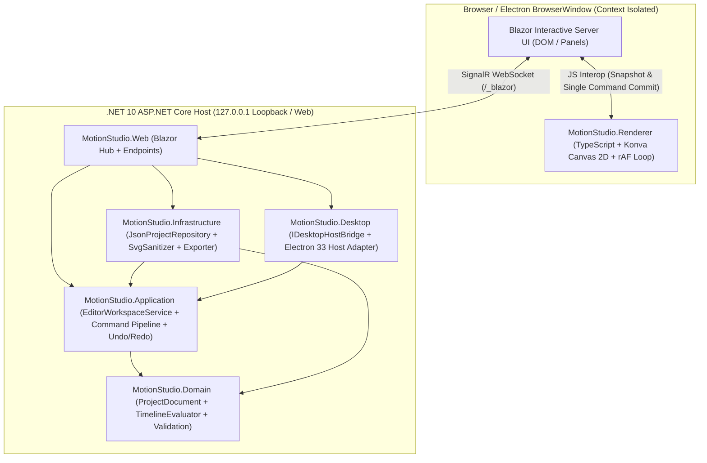

# ARCHITECTURE — 系统架构基线

- **文档版本**：`0.2.0`
- **当前状态**：`Accepted (Verified in P0)`
- **维护角色**：System Architect

## 1. 系统拓扑与双宿主运行形态

## 2. 模块职责与单向依赖契约

| 模块名称 | 目标框架 | 核心职责 | 严格禁止事项 |
|---|---|---|---|
| `MotionStudio.Domain` | `net10.0` | `ProjectDocument`, `Composition`, `LayerNode`, `Transform`, `AnimationTrack`, `Keyframe`, `TimelineEvaluator` 确定性插值算法与领域校验 | 禁止依赖 Blazor、ASP.NET Core、System.IO 文件读写、Electron 或前端类型 |
| `MotionStudio.Application` | `net10.0` | `EditorWorkspaceService`、命令信封 (`EditorCommandEnvelope`)、`DocumentRevision` 校验、Undo/Redo 栈、复制粘贴、动效预设及端口接口 | 禁止持有 DOM/Canvas/Konva 引用或直接操作磁盘路径 |
| `MotionStudio.Infrastructure` | `net10.0` | `.motion.json` Schema v1 序列化与迁移、同目录 `.tmp` 原子写入与 `.bak` 备份、`SvgSanitizerService`、`StaticExporterService` | 禁止反向依赖 `MotionStudio.Web` |
| `MotionStudio.Web` | `net10.0` | Blazor Interactive Server 五区工作台界面、JS Interop 协调器、健康与自检端点 | 禁止在 `.razor` 中执行逐帧插值计算或逐像素拖拽回调 |
| `MotionStudio.Renderer` | `ES2022` (TS) | Konva Canvas 2D 场景图、指针命中与拖拽预览、`requestAnimationFrame` 本地播放循环、Golden Vector 对齐插值器 | 禁止直接读写本地文件系统或调用 Node.js 特权 API |
| `MotionStudio.Desktop` | `net10.0` + Electron 33 | 桌面宿主桥接 (`IDesktopHostBridge`)、Loopback 端口与会话令牌校验、Electron 窗口生命周期与进程回收 | 禁止将桌面对象注入 `MotionStudio.Domain` |

## 3. 手势事务与状态一致性协议 (`NFR-005`)

1. **起始 (`pointerdown`)**：`MotionStudio.Renderer` 命中目标图层，记录当前 `baseRevision` 与起始 `Transform`，开启本地预览会话 (`InteractionSession`)。
2. **预览 (`pointermove`)**：仅更新 Renderer 内存中的 `previewTransform` 并在当前 `requestAnimationFrame` 重绘 Konva Stage；**期间向 Blazor/SignalR 发送 0 条消息**。若用户按下 `Escape`，立即丢弃 `previewTransform` 并恢复权威状态。
3. **提交 (`pointerup`)**：Renderer 将整次拖拽折叠为**单条版本化语义命令** (`MoveLayerTransformCommand`)，携带 `commandId`, `contractVersion: 1`, `documentId`, `baseRevision`, `timestamp`, `payload` 发送给 `EditorWorkspaceService`。
4. **权威合并**：`EditorWorkspaceService` 校验 `baseRevision == currentRevision` 后更新 `ProjectDocument`，压入 Undo 栈，递增 `DocumentRevision`，并将最新快照返回 Renderer 合并。

## 4. 关键帧采样双端等价性 (`FR-009`)

- 关键帧以整数 `frameIndex` 存储，彻底规避浮点时间累加漂移。
- `MotionStudio.Domain.TimelineEvaluator` (C#) 与 `MotionStudio.Renderer/src/engine/interpolation.ts` (TypeScript) 采用完全相同的数学定义（包含 `Linear`, `EaseIn`, `EaseOut`, `EaseInOut`, `CubicBezier` 牛顿迭代求解及 `#RRGGBB` 色彩通道线性插值），并通过相同的 Golden Vectors 单元测试验证。
